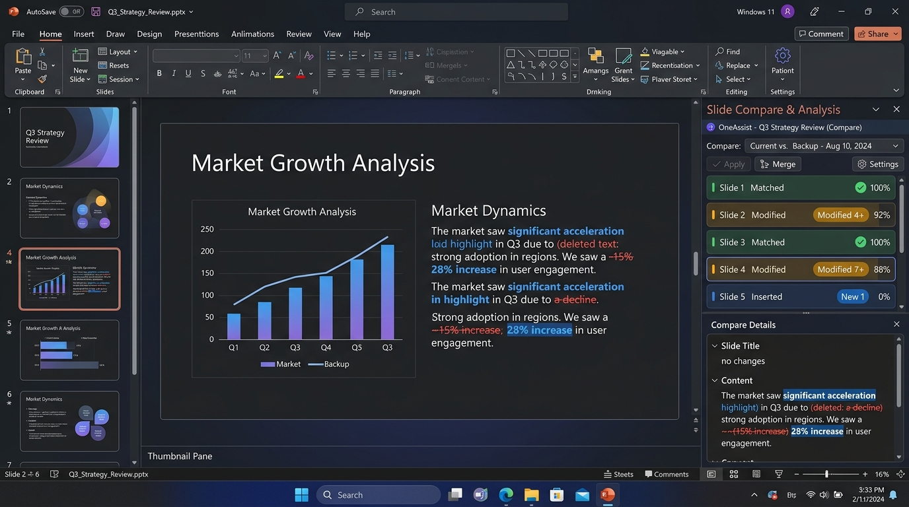
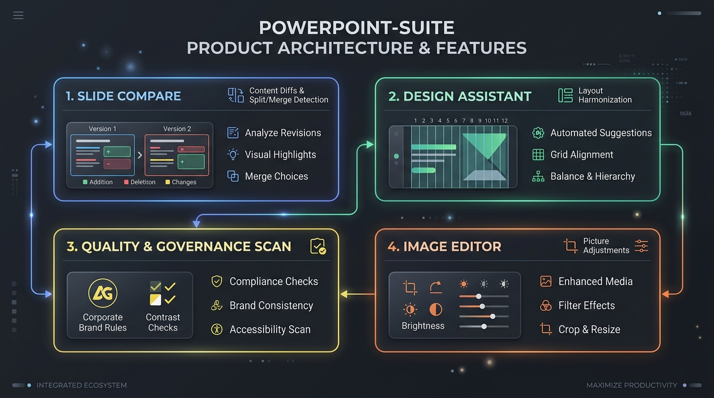
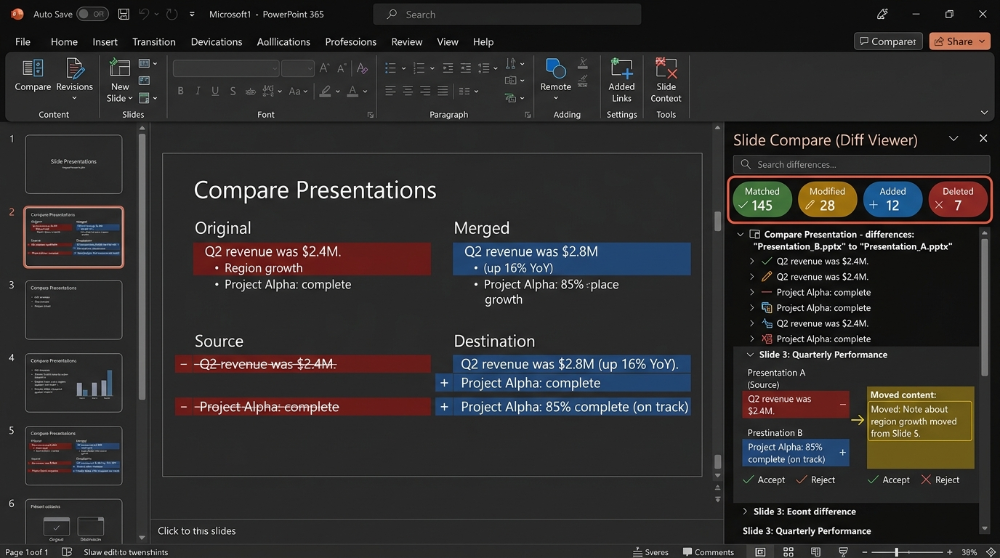
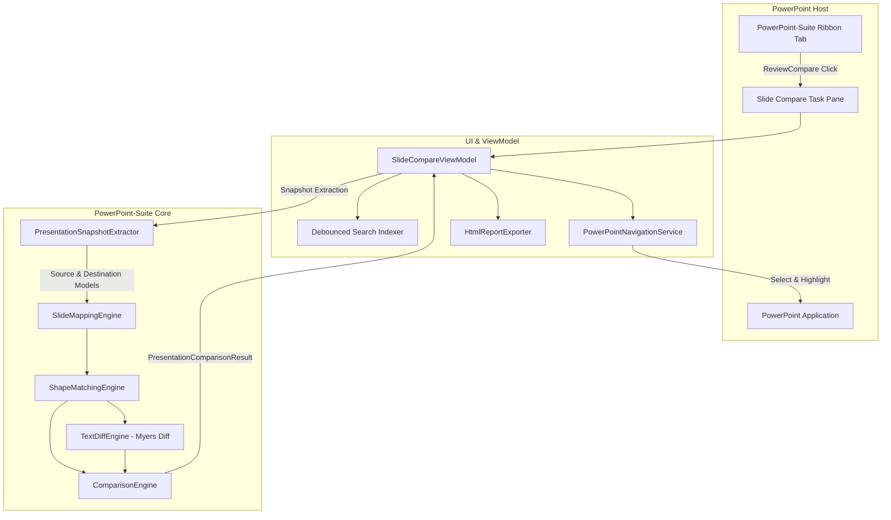

# PowerPoint-Suite ⚡ Advanced PowerPoint VSTO Add-in

[](https://learn.microsoft.com/en-us/visualstudio/vsto/)
[](https://dotnet.microsoft.com/)
[](#-automated-testing)
[](LICENSE)
[](#-powerpoint-native-dark-theme)

> **PowerPoint-Suite** is an enterprise-grade productivity suite for Microsoft PowerPoint. It combines an intelligent content-first **Slide Compare** engine, automated **Design Assistant**, embedded **Image Editor**, and comprehensive **Quality & Governance Deck Scanner** directly within PowerPoint's native Ribbon and task panes.

---



---

## 🚀 Key Modules & Capabilities



### 1. ⚡ Intelligent Slide Compare & Content Difference Engine
*Detects semantic changes, text diffs, slide permutations, and split/merged decks without relying on fragile slide IDs.*

- **Content-First Matching**: Intelligently analyzes slide titles, paragraph fingerprints, shape types, and topological positions to match content accurately even when slides are inserted, deleted, or reordered (e.g. `Slide 1↔1`, `Slide 2↔2`, `Slide 3↔4`, `Slide 4↔3`).
- **Complex Deck Restructuring Recognition**:
  - `Split Detection`: Identifies when content from one dense source slide is divided across multiple slides (`1 → N`).
  - `Merged Detection`: Identifies when content from multiple source slides is condensed into a single slide (`N → 1`).
  - `Moved & Position Tracking`: Captures shapes that migrated positions or swapped coordinates with clear coordinate diffs.
  - `Reordered Slides`: Detects structural shifts in the presentation narrative flow.

---



### 2. 🎨 Visual Difference Highlighting
- **Word-Level Precision**:
  - <span style="color:#ef4444; text-decoration:line-through; font-weight:bold;">− Red Strikethrough</span>: Content removed from destination presentation.
  - <span style="color:#38bdf8; font-weight:bold;">+ Bold Blue</span>: Content newly inserted in destination presentation.
  - <span style="color:#fbbf24; font-weight:bold;">↔ Warm Yellow</span>: Content moved, repositioned, or shifted.
  - <span style="color:#22c55e; font-weight:bold;">✓ Vibrant Green</span>: Content matching perfectly between decks.
- **Side-by-Side Comparison Cards**: Dedicated `SOURCE`, `DEST`, and `DIFFERENCE` panels for instant review.
- **One-Click Slide Jump**: Clicking any slide or shape in the task pane instantly navigates and selects the target shape in the active PowerPoint window.

### 3. 🔍 Fast Debounced Search & Minimalist Icon Toolbar
- **Ultra-Fast Search**: High-performance debounced search indexing allows instant querying of slide numbers, shape names, and text content across 100+ slide decks with zero UI lag. Includes search icon `🔍` and one-click clear button `✕`.
- **Icon-Only Header**: Streamlined top toolbar featuring clean icon-only controls with tooltips:
  - `📁` **Files Toggle**: Easily collapse or reveal the source/destination presentation selection pane.
  - `🗖` / `🗗` **Restore / Maximize View**: Expand results area to fill 95%+ of the vertical task pane.
  - `⚙` **Settings**: Quick flyout for granular comparison toggles (Text, Shapes, Tables, Charts, Formatting, Position, Notes, Hidden Slides, Threshold).

### 4. 🌙 PowerPoint Native Dark Theme
- Painstakingly designed to integrate seamlessly into PowerPoint's official dark mode palette (`#202020` task pane background, `#2B2B2B` cards, `#383838` borders, PowerPoint signature `#D24726` accents).

### 5. 🛠️ Extended Suite Tools
- **Design Assistant**:
  - **12-Column Responsive Slide Grid**: Calculates uniform column gutters and enforces slide printable margins.
  - **Layout Harmonization**: Detects visual families and aligns repeating card / KPI layouts across slides.
- **Image Editor**:
  - In-presentation image brightness, contrast, crop, sharpen, and filter adjustments without leaving PowerPoint.
- **Quality & Governance Scanner**:
  - Automated compliance auditing against corporate font policies, minimum font sizes, and contrast requirements.
  - **Health Score**: Real-time 0–100% presentation quality rating.
  - **Safe Auto-Fix**: Multi-tier fix categorization (`Safe`, `Review`, `Dangerous`) with undo snapshots.

---

## 🏛️ System Architecture



---

## 📁 Repository Structure

```
PowerPoint-Suite/
├── OneAssist/                       # Main VSTO Add-in Project (.NET Framework 4.8)
│   ├── Ribbon1.cs                   # PowerPoint-Suite Ribbon definitions & handlers
│   ├── Ribbon1.Designer.cs          # Native Ribbon controls (ReviewCompare icon, buttons)
│   ├── SlideCompare/                # Standalone Slide Compare Module
│   │   ├── Comparison/              # ComparisonEngine & Diff calculations
│   │   ├── Extraction/              # Fast COM Presentation Snapshot Extractor
│   │   ├── Matching/                # SlideMappingEngine, ShapeMatchingEngine, TextDiffEngine
│   │   ├── Models/                  # Data contracts, snapshots, tokens, and enums
│   │   ├── Navigation/              # PowerPoint COM selection and navigation service
│   │   ├── Services/                # ComparisonService & HTML Report generation
│   │   └── UI/                      # SlideCompareControl.xaml, ViewModel, Converters
│   ├── ImageEditor/                 # Embedded picture enhancement module
│   └── Properties/                  # Assembly info and manifest configuration
├── OneAssist.Tests/                 # Automated Unit & Integration Test Suite (.NET 8.0)
│   └── Program.cs                   # 120 Comprehensive Test Suites
├── docs/assets/                     # High-resolution screenshots and architecture diagrams
│   ├── diff_viewer.jpg              # Slide compare diff view visual
│   ├── hero_banner.jpg              # Hero banner image
│   └── suite_overview.jpg           # Product architecture infographic
├── LICENSE                          # Personal & Non-Commercial Use License
└── README.md                        # Documentation
```

---

## 🧪 Automated Testing

PowerPoint-Suite includes an automated test runner validating **120 distinct scenarios** across semantic comparison, Myers diff tokenization, slide permutations, layout grids, and enterprise governance:

```bash
dotnet run --project OneAssist.Tests/OneAssist.Tests.csproj
```

```
================================================================================
    ALL 120 TEST SUITES PASSED CLEANLY (0 FAILS)!
================================================================================
```

### Verified Test Categories:
1. **Myers Word-Level Diff**: Exact insertion, deletion, and substitution boundaries.
2. **Slide Permutations**: Swapped slides (1↔1, 2↔2, 3↔4, 4↔3) recognized without false positives.
3. **Split & Merged Decks**: Content redistribution across 1-to-many and many-to-1 slides.
4. **Position & Geometry**: Moved shape detection with coordinate diff reporting.
5. **Formatting Differences**: Font family, size, bold/italic, color modifications.
6. **Cancellation & Async**: Immediate responsiveness to user abort requests during large deck scans.
7. **Fast Debounced Search**: Cached indexed text retrieval across slides and shapes.
8. **Corporate Governance & Auto-Fix**: Policy locks, brand color compliance, and safe fix rollbacks.

---

## 📄 Standalone HTML Report Export

Export comparison results to a self-contained, offline-compatible HTML report:
- Matches the PowerPoint native dark theme palette.
- Interactive category filtering (Matched, Modified, Added, Deleted, Moved, Reordered, Split, Merged).
- Dynamic client-side search box.
- Expandable/collapsible slide diff tree.

---

## 📜 License

This project is licensed strictly for **Personal & Non-Commercial Use**.  
For commercial use, enterprise deployment, or redistribution, please contact the maintainer to obtain a commercial license.  
See the [LICENSE](LICENSE) file for complete terms.
