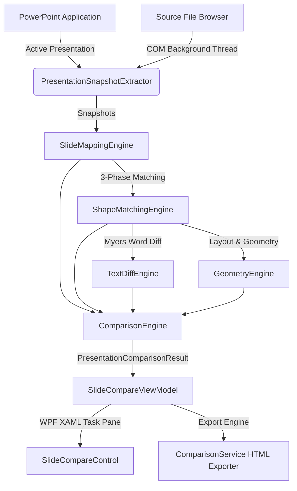

# OneAssist ⚡ PowerPoint VSTO Suite

[](https://learn.microsoft.com/en-us/visualstudio/vsto/)
[](https://dotnet.microsoft.com/)
[](#test-suite)
[](LICENSE)
[](#ui-design)

> **Next-generation intelligent PowerPoint VSTO productivity suite featuring an enterprise-grade Slide Compare engine, content difference visualization, layout harmonizer, and slide governance toolkit.**

---


---

## 🌟 Key Capabilities

### ⚡ 1. Intelligent Slide Compare & Difference Engine
- **Content-First Semantic Comparison**: Does not rely on fragile Slide IDs or Shape indices. Maps slides and shapes based on title similarity, text fingerprinting, layout topology, and visual geometry.
- **Accurate Permutation & Flow Detection**:
  - `1-to-1 Slide Matching`: Identifies exact or reordered slides (e.g. `Slide 1↔1`, `Slide 2↔2`, `Slide 3↔4`, `Slide 4↔3`).
  - `Split Slide Detection`: Detects when dense content from 1 source slide is distributed across multiple destination slides (`1 → N`).
  - `Merged Slide Detection`: Detects when content from multiple source slides is consolidated into 1 destination slide (`N → 1`).
  - `Reordered / Moved Detection`: Detects slides that swapped order or shapes whose coordinates changed.

### 🎨 2. Rich Visual Difference Highlighting
- **Word-Level & Token-Level Precision**:
  - <span style="color:#ef4444; text-decoration:line-through; font-weight:bold;">− Red Strikethrough</span>: Removed / deleted text tokens.
  - <span style="color:#38bdf8; font-weight:bold;">+ Bold Blue</span>: Inserted / newly added text tokens.
  - <span style="color:#fbbf24; font-weight:bold;">↔ Yellow</span>: Moved content, relocated positions, or reordered elements.
  - <span style="color:#22c55e; font-weight:bold;">✓ Green</span>: Identical matched content shapes and slides.
- **Dedicated Shape Panels**: Clean `SOURCE`, `DEST`, and `DIFFERENCE` comparison cards with one-click PowerPoint slide navigation.

### 🗖 3. Adaptive UI & Maximize Workspace
- **Auto-Compact Layout**: Upon comparison execution, the presentation selection card automatically collapses, dedicating ~90%+ of the vertical task pane directly to difference inspection.
- **Quick Expand / Collapse**: One-click `🗖` / `🗗` Maximize button with smart tooltips to toggle between full configuration and maximized results view.
- **Interactive Metrics Dashboard**: Clickable pills for **Matched**, **Modified**, **Added**, **Deleted**, **Moved**, **Reordered**, **Split**, and **Merged** with instant list filtering.

### 📄 4. Standalone Dark-Mode HTML Report Export
- Single self-contained HTML file styled identically to the VSTO dark interface.
- Embedded client-side JavaScript for instant search, category filtering, and accordion expand/collapse.
- Opens in any modern web browser without dependencies.

### 🛠️ 5. Extended Presentation Toolkit
- **Shape Inspector**: Dual coordinate measurement system (Points & Inches).
- **12-Column Responsive Grid**: Strict slide margin enforcement and dynamic alignment.
- **Chart Label Formatter**: Auto-formats financial and metric labels (`$1.2M`, `35%`, `12x`).
- **Health Score & Quality Rules**: Automated deck audits for corporate governance, font consistency, and contrast compliance.
- **Safe Auto-Fix Engine**: Three-tier classification system (`Safe`, `Review`, `Dangerous`) with undo snapshots.

---

## 🏛️ Architecture Overview



---

## 📁 Repository Structure

```
OneAssist/
├── OneAssist/                       # Main VSTO Add-in Project (.NET Framework 4.8)
│   ├── SlideCompare/                # Standalone Slide Compare Module
│   │   ├── Comparison/              # ComparisonEngine & SlideComparisonEngine
│   │   ├── Extraction/              # Fast COM Snapshot & Text Extractor
│   │   ├── Matching/                # SlideMappingEngine, ShapeMatchingEngine, TextDiffEngine
│   │   ├── Models/                  # ComparisonResult, Snapshots, Enums, Settings
│   │   ├── Services/                # ComparisonService & PowerPointNavigationService
│   │   └── UI/                      # SlideCompareControl.xaml, ViewModel, Converters
│   ├── ImageEditor/                 # PowerPoint Image Editing & Adjustment Module
│   └── Properties/                  # Assembly info and manifest configuration
├── OneAssist.Tests/                 # Automated Unit & Integration Test Suite (.NET 8.0)
│   └── Program.cs                   # 120 Comprehensive Test Suites
├── docs/assets/                     # Screenshots, architecture diagrams, and banners
├── LICENSE                          # Personal & Non-Commercial Use License
└── README.md                        # Documentation
```

---

## 🧪 Test Suite

OneAssist includes an automated test runner validating 120 distinct scenarios across content comparison, permutation recognition, semantic classification, layout grids, and enterprise governance:

```bash
dotnet run --project OneAssist.Tests/OneAssist.Tests.csproj
```

```
================================================================================
    ALL 120 TEST SUITES PASSED CLEANLY (0 FAILS)!
================================================================================
```

---

## 🚀 Building & Running

### Prerequisites
- Windows 10 / 11
- Microsoft PowerPoint 2016, 2019, 2021, or Microsoft 365
- Visual Studio 2022 with **Office/SharePoint development** workload
- .NET Framework 4.8 Developer Pack
- .NET 8.0 SDK (for running the test suite)

### Build via MSBuild
```powershell
& "C:\Program Files\Microsoft Visual Studio\2022\Community\MSBuild\Current\Bin\MSBuild.exe" "OneAssist\OneAssist.csproj" /t:Build /p:Configuration=Debug
```

---

## 📜 License

This project is licensed under the **Personal and Non-Commercial Use License**.

- **Permitted**: Free for personal, non-commercial, and educational exploration.
- **Restricted**: Commercial use, redistribution, or integration into commercial software requires an explicit commercial license.
- For commercial licensing inquiries, please contact the author via [GitHub](https://github.com/vijairathina/PowerPoint-VSTO-OneAssist).

See the [LICENSE](LICENSE) file for complete terms.
